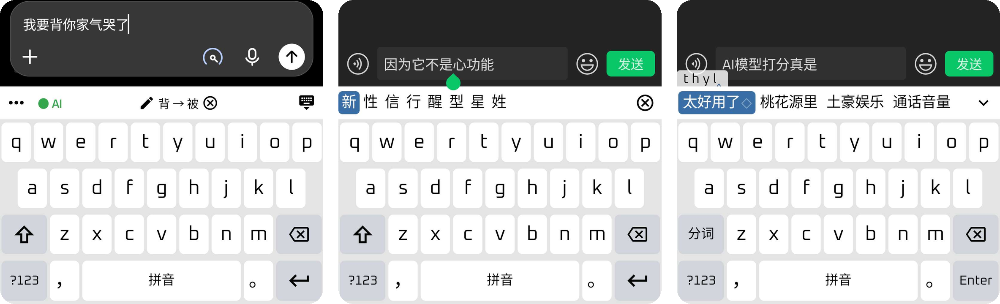

# suzu-ime

<p align="center">
  <br>
  <sub>Android 预览：GBoard 风格布局。左：打完后面的字，工具栏提示把选错的“背”改成“被”。中：光标点到“心”上，候选栏按整句分列出同音字。右：简拼 <code>thyl</code> 按上文排出“太好用了”，<code>◇</code> 表示模型参与了这次排序。</sub>
</p>

基于 Rime 的本地 AI 拼音输入法：包含 Android App（改版同文输入法）和 macOS、Windows 共用的推理核心，按上文重排候选、补全简拼。

Android 版可从 [发布页](https://github.com/1zumiii/suzu-ime/releases/latest) 下载。其他平台的配置和安装包见 [rime-suzu](https://github.com/1zumiii/rime-suzu)，模型说明与训练见 [Suzu](https://github.com/1zumiii/Suzu)。

Suzu 根据光标前的文字为同音候选打分，也会补充 Rime 未给出的简拼候选。Android 默认使用 6 层的 Suzu-UER6-PG200（约 52.8 MB），桌面默认使用 12 层的 Suzu-UER12-PG100（约 98.2 MB）。PG100 的首选准确率较高，单次打分耗时约为 PG200 的两倍。三端均在本机推理，输入内容不出设备。

## 效果

同一批固定候选只按模型分排序，首选准确率为正确答案排在第一位的题目占比：

| 评测 | 题数 | Suzu-UER6-PG200（Android 默认） | Suzu-UER12-PG100（桌面默认） | Suzu-UER6-KD500（上一版） |
|---|---:|---:|---:|---:|
| 两字母简拼，每题 48 个候选 | 2,400 | 61.9% | 63.7% | 59.5% |
| 全拼同音词，每题最多 5 个候选 | 1,293 | 93.43% | 93.50% | 92.81% |

在鼠须管的 librime 中逐键输入两字母简拼题，首位门控 1.5。按帖子划分的验证集上，首选准确率如下：

| 设置 | 题数 | 首选 |
|---|---:|---:|
| 不用模型分（同一批候选按 Rime 原名次排序） | 1,195 | 28.5% |
| Suzu-UER6-KD500（上一版） | 1,190 | 54.0% |
| Suzu-UER6-PG200（Android 默认） | 1,195 | **56.4%** |
| Suzu-UER12-PG100（桌面默认） | 1,190 | **58.2%** |

三个模型的验证集按同一规则划分，题数略有差别，不是逐题配对。评测条件见模型卡：[PG200](https://huggingface.co/IzumiThe3rd/Suzu-UER6-PG200)、[PG100](https://huggingface.co/IzumiThe3rd/Suzu-UER12-PG100)。

延迟与内存：

| 平台 | 条件 | Suzu-UER6-PG200 | Suzu-UER12-PG100 |
|---|---|---|---|
| Android | ASUS Zenfone 10，守护进程 2 线程，每组 10 个候选 | 打分加生成的 P99 约 20 ms，与 KD500 相差 1 ms 以内，常驻内存约 150 MiB | 约慢一倍，连续输入时约 12% 的请求超过 45 ms 时限，常驻内存约 282 MiB |
| Windows | 桌面 4 线程，每题 10 个候选 | 上文已缓存时 P50 / P99 为 5.6 / 7.7 ms，现场解码上文时为 9.6 / 22.7 ms | 上文已缓存时 10.5 / 14.4 ms，现场解码上文时为 19.0 / 46.2 ms |

推理请求设有等待时限，超时后当次输入继续使用已有候选。各平台的按键仿真见 [技术报告](docs/technical-report.md)。

Android 真实使用中的打分耗时（同一台 ASUS Zenfone 10，取自守护进程的统计）：

| | 旧核心 | 新核心，优化前 | 新核心，优化后 |
|---|---:|---:|---:|
| 中位数 | 17～30 ms | 8.5 ms | 6.6 ms |
| p99 | 未统计 | 35.9 ms | 31.1 ms |
| 最大 | 105 ms | 62.6 ms | 41.4 ms |

优化后一段用的是 KD500，其余两段是 Suzu 字符级模型。各段的条件和优化内容见 [技术报告：Android 真实使用对比](docs/technical-report.md#android-真实使用对比)。

## 功能

- 重排：按上文为同一拼音的候选打分，调整顺序。
- 候选生成：简拼和混合输入时，从词典中按上文筛选 Rime 未给出的词，补充到候选窗。
- 统一排序：总分 = Rime 名次先验 + 上文权重 × 模型分 + 个人习惯。关闭 AI 时上文权重为 0，其余项保持不变。
- 个人习惯：最近使用、词对和纠错记忆均只保存在本机。
- 选错修正（Android）：停顿后检查句中刚选过的词。换成同页的同音候选后整句更通顺时，工具栏提示“A → B”，点按才替换。光标点到文字上时，候选栏列出可替换的同音候选，点选后只替换对应片段。
- 输入事件流：默认关闭，开启后在本机记录选词、上屏与删除，用于校准参数。
- 设置与状态（Android）：“设置 → AI 与输入辅助”可单独开关以上各项，默认全部开启。功能状态页显示 AI 服务、排序方式和各类记录的状态。
- 键盘配色（Android）：“虚拟键盘”可开启“跟随应用深浅色”。Android 14 及以上若能取得当前输入框的文字颜色，键盘会据此切换深浅色。
- 词库管理（Android）：在线名录提供词库包和附加词库。口语句式可补充“解没解决”一类正反问候选。
- 设置备份（Android）：“配置与迁移”可导出和导入应用设置，也可导出包含词库与模型的 Rime 数据 ZIP。

## 平台

三端共用 `core/` 里的同一份推理与调度代码。没有模型文件时不重排，输入不受影响。

| 平台 | 前端 | 运行方式 |
|---|---|---|
| macOS | 鼠须管 | 进程内加载 `rime_llm.so` |
| Windows | 小狼毫 0.17 | 进程内加载 `rime_llm.dll` |
| Android | 改版同文输入法（Trime） | 常驻守护进程 `rimellmd`，须经 adb 或 Shizuku 启动 |

## 快速开始

### macOS 与 Windows

安装整套输入法（配置、词库、模型和推理核心）请用 [rime-suzu](https://github.com/1zumiii/rime-suzu#安装) 的一行安装命令，无需自己编译。

### Android

从 [发布页](https://github.com/1zumiii/suzu-ime/releases/latest) 下载 APK，支持 arm64、Android 11 及以上。

1. 安装后按引导启用并选择输入法，这时已经可以正常打字。
2. 在引导页或“设置 → 模型”下载打分模型，列表从新到旧排列，默认选最新的模型。
3. 安装并启动 [Shizuku](https://shizuku.rikka.app/)，再点工具栏的 AI 徽标启动 AI 服务。手机重启后要先启动 Shizuku，再启动 AI 服务。

词库在“设置 → 词库”中切换，详见 [Android 说明](android/README.md)。

Android 应用名为 `suzu-ime`，包名为 `izumiii.suzu.ime`。从旧版 Suzu 升级时，先覆盖安装 v0.5.2 过渡版，再安装并打开新版迁移。应用设置、用户词典和已下载的词库与模型均可保留。[迁移步骤](android/README.md#从旧包名迁移)

### 手动安装推理核心

已有自己的 Rime 配置，或想自己编译时，按以下步骤安装：

1. 下载 [Suzu-UER6-PG200](https://huggingface.co/IzumiThe3rd/Suzu-UER6-PG200) 或 [Suzu-UER12-PG100](https://huggingface.co/IzumiThe3rd/Suzu-UER12-PG100) 的 GGUF 权重和配套词表，分别保存为 `suzu.gguf` 和 `suzu.vocab.txt`。两个文件要成对使用，换模型时一起替换。
2. 按平台安装推理核心：
   - macOS：`macos/install_llm.sh core/build/rime_llm.so suzu.gguf suzu.vocab.txt`，详见 [macos/README.md](macos/README.md)
   - Windows：见 [windows/README.md](windows/README.md)
3. 核心的构建与接口见 [core/README.md](core/README.md)。

### 接入已有的 Rime 配置

先按上一节装好推理核心、权重和词表，再接入方案。将 `rime/lua/` 下的 Lua 文件放入 Rime 用户目录的 `lua/`，将 `rime/suzu_ime.yaml` 放入用户目录，再在目标方案的 `<方案名>.custom.yaml` 中添加：

```yaml
patch:
  __include: suzu_ime:/patch
```

重新部署后，方案即接入处理器、过滤器、AI 开关和快捷键（Control+Shift+5）。引用须放在 `patch` 下，并使用 `__include`。若使用 `__patch`，会替换方案原有的整个处理器与过滤器列表。若写在文件顶层，则不生效。

Lua 从 2 个字母起重排，每组打分 10 个候选，统一排序的名次先验系数为 0.05。开启候选生成时，把每组放大到 20 或 30 个候选，Suzu-2.4 在 1,600 道两字母简拼题上的首选没有变化（34.7%、34.6%、34.6%），手机上每多一个候选约多 0.5 ms，所以保持 10 个。Suzu-UER 系列的首位门控默认值为 1.5。继续使用 Suzu-2.4 时，可在同一个 `patch` 下将 `llm_rerank/unified/top_gate` 设为 2.5。其他配置键见 `rime/lua/ai_rerank_filter.lua` 和 `rank_unified.lua`。

## 文档

| 文档 | 内容 |
|---|---|
| [技术报告](docs/technical-report.md) | 各平台延迟与内存、候选生成对照、未验证项目 |
| [设计说明](docs/design/core-design.md) | 推理核心的结构与取舍 |
| [测量报告](docs/design/core-measurements.md) | 新旧核心对照、优化分项与故障注入 |
| [个人化](docs/personalization.md) | 个人习惯的记录与使用 |
| [多模型](docs/multi-model.md) | 多模型设计草案 |

## 目录

| 路径 | 内容 |
|---|---|
| `core/` | 推理核心：推理层、调度层、Lua 模块、守护进程与客户端 |
| `rime/lua/` | Rime 的 Lua 过滤器与处理器 |
| `rime/suzu_ime.yaml` | 方案补丁：把上述组件接到任意拼音方案上 |
| `android/` | 改版 Trime 源码、APK 构建脚本、守护进程部署脚本 |
| `macos/`、`windows/` | 各平台的安装、部署与回滚脚本 |
| `tests/` | 全部测试，`tests/run_all.sh` 一键运行 |
| `tools/` | 按键仿真、选词语料分析、离线回放、链路审计、基准 |

## 相关仓库

- 模型与训练：[Suzu](https://github.com/1zumiii/Suzu)。
- 配置与词库包：[rime-suzu](https://github.com/1zumiii/rime-suzu)，其中的重排 Lua 由本仓库的 `rime/lua/` 同步而来。
- 原项目：本项目起步于 [rime-llm-rerank](https://github.com/zhanghaozhecn/rime-llm-rerank)，推理核心已重写，Windows 的光标上文读取和部分 Lua 仍取自该项目。Android 前端硬分叉自 [osfans/trime](https://github.com/osfans/trime)。署名见 [NOTICE.md](NOTICE.md)。

## 许可

代码按 GPL-3.0 许可（[LICENSE](LICENSE)）。模型权重的许可见 Suzu 仓库。
